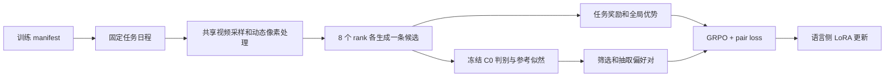

# 代码与训练协议

## 包职责

```text
configs/                  实验默认值、继承配置、本地路径模板
scripts/                  安装、单机 torchrun 训练/评估、数据准备和测试
src/vtg/
  cli/                    命令行解析，延迟加载模型依赖
  config.py               配置继承、环境变量展开、约束校验
  data/                   Time-R1 / Charades / TVGBench 格式与 manifest
  video/                  PTS 采样、动态像素预算、有限缓存、PyAV 解码
  tasks/                  任务 schema、提示词、参考语义与候选解析
  rewards/                时间 IoU、格式分、字段绑定和动词奖励
  models/                 Qwen 处理器、语言侧 LoRA、冻结参考适配器
  preference/             冻结判别、偏好筛选、分布式 pair loss、覆盖率
  training/               日程、rollout、GRPO、HF Trainer、恢复和入口
  evaluation/             分片推理、预测合并、指标和 video bootstrap
  utils/                  文件读写、内容哈希和分布式基础操作
tests/                    协议、解码、模型、梯度与恢复验证
```

模块不导入原工程的 `event_aux`、`contrastive_vtg`、vendor 路径，不操作 `sys.path`。GRPO 使用独立的显式损失函数，HF Trainer 与 Accelerate 管理 DeepSpeed/DDP、优化器、累积、checkpoint 和进度条。无需安装 TRL 或将旧的 Invert4TVG 仓库放到 Python 路径中。

训练入口同时支持 `torchrun main.py --model_name_or_path ...` 风格的显式参数与 JSON 配置。参数在 `cli/arguments.py` 统一校验，再由 `training/options.py` 接入 HF。默认 `scripts/train.sh` 在脚本中列出八卡参数；`scripts/train_from_config.sh` 保留纯配置用法。数据准备采用跨进程文件锁，支持 Time-R1 列表和 Charades 视频字典。

`save_strategy=epoch` 根据任务日程中的真实 data_epoch 决定保存更新点，跨越 epoch 边界时在该 optimizer update 完成后保存。HF 自身看到的是合成的完整训练日程，因此这里不能直接使用其 dataset epoch 回调。

## 一个训练微步

1. 从不可变日程中按 `optimizer_step × accumulation + micro_index` 获取任务。
2. 所有 rank 读取同一视频区间，核对提示词与实际帧指纹。
3. 每卡独立随机生成一条候选，得到一个全局 G8 组。
4. 按 TVG / SCC / SER / ED 计算真实完成文本的奖励。
5. 在无梯度上下文切换到冻结参考，计算 completion log-prob；需要偏好时检查 GT 与候选视频片段。
6. 汇总候选，从符合 IoU、语义、输入差异条件的组合中均匀抽取一对。
7. 切回 actor，仅建立一次有梯度 forward，计算 GRPO + 加权 pair loss，再 backward。
8. 累积四个独立问题后更新 LoRA。



N1 保留 GT 的完整描述支持门控，但不要求候选 `match=yes`；候选仍须成功解码、IoU ≥ 0.3、IoU 差 ≥ 0.1，且教师实际输入不同。N2 额外要求候选 `match=yes`。权重为 `min(IoU_gap / 0.3, 1)`。偏好来自实际 rollout，没有人为合成高分候选。

## 动态视觉预算

默认每帧最小目标面积为 12,544，最大面积硬上界为 602,112，`total_pixels` 为 2,809,856。T 帧对应：

```text
Pmax(T) = max(min(602112, 2809856 × 2 / T), 13171)
```

宽高保持长宽比，按 28 对齐。这里沿用原来的 round/floor/ceil 行为，因此 minimum 是目标预算，不能把每次取整后的面积声称为严格等于或严格大于 minimum。长视频还受到 minimum floor 的影响，`total_pixels` 不是所有帧面积之和的严格上限。另用 `visual_token_cap=9216` 检查实际处理器输出。

768 帧只是上限。长视频在完整区间均匀降低有效 FPS，短片段允许重复已有帧补足最小偶数帧。采样采用真实 PTS，沿用原项目的窗口与 media_offset 约定；像素分配参考 Invert4TVG，但并不宣称逐帧复刻其所有视频后端的采样结果。

解码只保存选中的帧，空间缓存仅保留最近一个请求，扫描元数据采用有限 LRU。处理器明确 `do_resize=False`，禁止第二次重置视频分辨率。训练、判别和评估均通过 `encode_video` 校验实际视觉 token 数。

## 梯度与冻结参考

默认 ZeRO-3 将基础模型参数分片并卸载到 CPU。视觉编码器、投影层和基础语言权重冻结。仅语言 attention 的 q/k/v/o LoRA 可训练。继续训练使用同一个基础模型上的 actor 与 `frozen_C0` 两个适配器，避免再放一份 7B 参考模型。

参考 log-prob 及判别在 actor forward/backward 之前完成。冻结适配器先以 FP32 注册并载入；ZeRO-3 引擎按训练精度统一转换为 BF16，冻结检查以同一精度比较。生成与判别共用一次全模型聚合上下文并暂时移除 ZeRO hooks，允许 rank 间生成长度、判别次数与缓存命中不同，退出时通过 finally 恢复 hooks。保存导出的 LoRA 时只写 actor；完整 DeepSpeed 状态另存分片，恢复时从父 checkpoint 重建 C0。

偏好项对 completion 全部有效 token 的相对 log-prob 求和，包含 EOS、排除 prompt 与 padding。跨卡收集远端值时 detach，仅本卡候选保留梯度，再乘 world_size 抵消数据并行的梯度平均。HF Trainer 单独负责除以 accumulation，不能重复缩放。DeepSpeed 的 backward 显式沿用 HF 的 `scale_wrt_gas=False`，避免第二次除以累积步数。ZeRO-3 使用 reentrant 梯度检查点，并为冻结 embedding 的输出启用输入梯度；DDP 保留 non-reentrant。支持 ZeRO-3 和 DDP，不支持 FSDP。

## 数据与结果

训练 manifest 每行至少包含：`sample_id`、`video_id`、`video_relpath`、`query`、`duration_sec`、`gt_sec`、`media_offset`、`split`、`semantics`。时间标注保持原始局部坐标，仅解码时加 media_offset。辅助语义仅从训练问题构建。

测试集保留全部发布问题，包含 point GT、超出可用视频长度的原始 GT 和明确记录的坏输入。绝不通过裁剪 GT 或丢弃失败问题提高 IoU。Charades 与 TVGBench 分别报告。

主要训练产物：

| 文件 | 内容 |
|---|---|
| `backend.json` | 实际引擎、ZeRO stage、CPUAdam、分片参数数目与填充后的 DeepSpeed 配置 |
| `resolved_config.json` | 实际配置与最终更新数 |
| `run_identity.json` | 数据、日程、代码、父模型和基础模型内容哈希 |
| `task_schedule.jsonl` | 完整任务顺序 |
| `rollouts.rankN.jsonl` | 候选文本、奖励、帧信息 |
| `pair_diagnostics.jsonl` | 全局候选、门控、有效对、失败原因 |
| `losses.rankN.jsonl` | GRPO、pair loss、KL |
| `checkpoint-N/` | 独立 actor LoRA、DeepSpeed 分片或 DDP 优化器、调度器、各 rank RNG 和日程状态 |
| `model/` | 当前训练阶段结束时的 actor，可能是暂停步骤 |
| `status.json` | 完成/暂停状态、冻结检查、rank 同步检查和显存 |
| `coverage.json` | 仅覆盖率阶段的训练问题统计 |

恢复要求配置、代码、数据、权重、GPU 数和 G 值一致。改变这些条件应重新开始一个新目录，不能作为同一优化器轨迹继续。训练旧目录最后一次失败产生的超前日志会归档到 `discarded_attempts/`。

评估输出包括逐卡 JSONL、按 annotation 顺序合并的 `predictions.jsonl`、身份文件和 `metrics.json`。指标只在预测集合与完整评估样本严格对应后生成。
